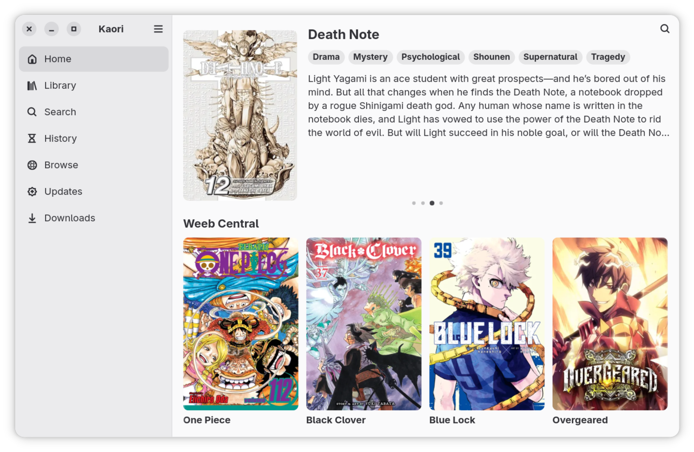
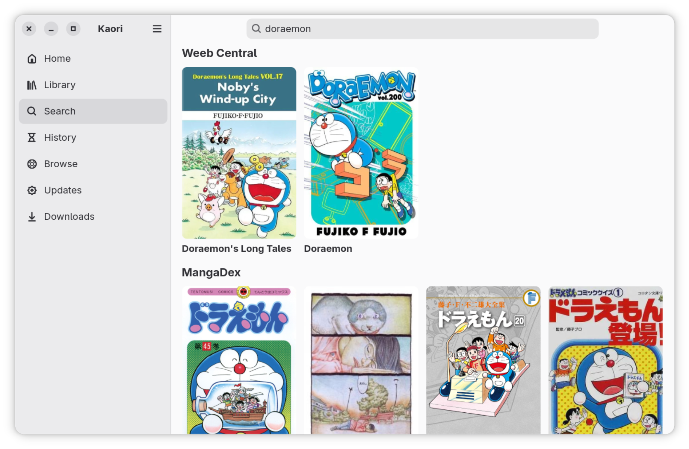
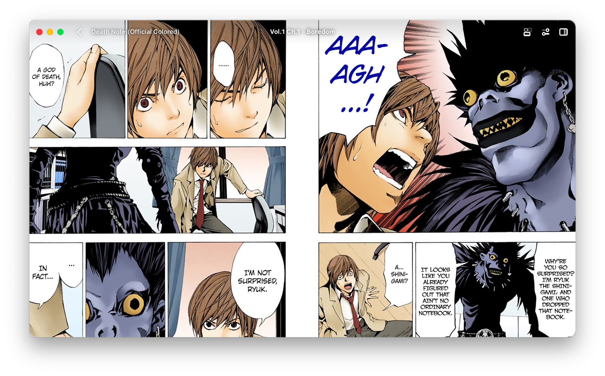

<h1 align="center">Kaori</h1>
  
Kaori allows you to discover, download and read comics with a beautiful looking UI, and natural touchpad gestures.

The name Kaori is a small tribute to Kaori Miyazono from *Your Lie in April*, a character who left a lasting impression on me.

## Features

- A beautiful libadwaita UI
- Browse and search comics from dozens of sources
- Download chapters for offline reading
- Built-in reader with single-page, double-page, and webtoon (continuous scroll) modes
- Natural touchpad gesture navigation (Pinch to zoom/two-finger scroll to move)

Kaori connects to/runs [Suwayomi](https://github.com/Suwayomi/Suwayomi-Server) as the backend.
(The current app icon is a placeholder, inspired by Komikku's)

  

### Installation
You can install Kaori as flatpak on Linux or a .DMG on macOS 
<table>
  <tr>
  <td>
    

      
    

  </td>
  <td>
    

      
    

  </td>
  <td>
    

      
    

  </td>
  </tr>
</table>

## Screenshots

<table>
  <tr>
    <td align="center">
      
       
      <strong>Search</strong>
    </td>
    <td align="center">
      
       
      <strong>Reader</strong>
    </td>
  </tr>
  <tr>
    <td align="center">
      
       
      <strong>Comic Details</strong>
    </td>
    <td align="center">
      
       
      <strong>Downloads</strong>
    </td>
  </tr>
</table>

## Code of Conduct
This project follows the [GNOME Code of Conduct](https://conduct.gnome.org/)

## Special Thanks to
<table>
  <tr>
    <td>Jaish Khan (for the macOS CI)</td>
  </tr>
  <tr>
    <td>Oween Unda (for the Flatpak CI)</td>
  </tr>
</table>
